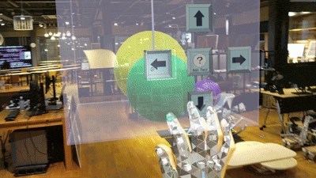

# 3Dsmile - 高齢者の空間認知を鍛えるMRパズルゲーム

HoloLens 2で、遊びながら空間認知能力のトレーニングができるMRコンテンツです。
ランダムに現れる「顔(球体)」を同じ表情同士で合体させ、最終的に「笑顔」を完成させると勝利です。
2024年度の作品制作として、個人で約1か月かけて開発しました(自主制作)。

## デモ

### プレイの様子

## 制作の背景

高齢になると、距離感や位置関係を把握する力が低下し、転倒などのリスクが高まります。
認知トレーニングはこうした力の維持・改善に重要ですが、従来のトレーニングは単調で続けにくいという課題がありました。
そこで、「スイカゲーム」の発想をもとに、遊びながら自然と脳を使えるMR体験を考えました。

## 遊び方

1. ランダムに出現する顔(球体)を、落下位置を調整して箱に落とす
2. 同じ表情同士が接触すると融合し、より笑顔に近い表情に変化する
3. 最終的に「笑顔」を作ることができたら勝利

## 主な機能

- **ランダム生成**:顔(球体)がランダムに出現します
- **表情のマージ**:同じ表情同士が接触すると融合し、笑顔に近い表情に変化します
- **落下位置の操作**:矢印ボタンで、顔を落とす位置を調整できます
- **視点移動**:ボックスの周りを360度、好きな角度から見ながら操作できます

## 使用技術

- Unity 2022.3.10f1
- HoloLens 2
- Mixed Reality Toolkit (MRTK) 2.8.3
- Mixed Reality OpenXR Plugin 1.11.1
- OpenXR Plugin 1.8.2
- C#

## 工夫した点・苦労した点

### 1. 合体するほど笑顔に近づく仕組みにした
パズルの顔が少しずつ笑顔になっていくと、プレイしていて楽しい気持ちになると考え、
同じ表情を合体させるごとに笑顔に近づく表情変化を実装しました。

### 2. 見やすさを考えて、色をビビットな原色寄りに変更した
もともとはパステルカラーを採用していましたが、見えにくい・識別しにくいという声がありました。
そこで、ビビットな原色寄りの色に変更しました。

### 3. 一方向の操作から、360度の操作に変更した
もともとは、クレーンゲームのように一方向から操作する形にしていました。
しかし、MRならではの特徴を活かすには、360度から操作できるほうがよいと考え、実装しました。

## 今後の課題

基本機能は実装済みですが、次の点は未実装で、今後の重要な改善点と考えています。

- 顔が箱からはみ出した際のエラー判定
- 次に出現する表情の表示(戦略性を高めるUI)
- ゲーム性と操作の分かりやすさの強化

## 使用アセット・クレジット

- Mixed Reality Toolkit 2.8.3(Microsoft、MITライセンス)
- 顔の表情やボックスの画像は、PowerPointで自作しました。

## 注意事項

MRTKなどのライブラリは、このリポジトリに含めていません。
そのため、Unityでプロジェクトを開くと、パッケージの読み込みエラーが出ることがあります。
